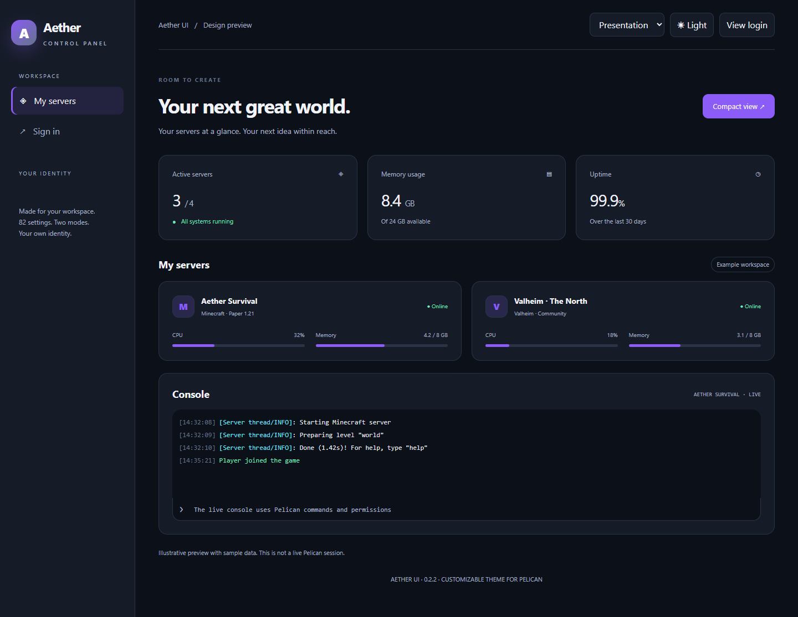

# Aether UI

A customizable theme plugin for Pelican Panel by BernyC. Shape your workspace with light and dark palettes, readable layouts and your own branding.

[Download](https://github.com/BernyCampos/aether-ui/releases/latest) · [Installation help](docs/TROUBLESHOOTING.md) · [Report an issue](https://github.com/BernyCampos/aether-ui/issues)



## Requirements

Pelican Panel **1.0.0-rc.2**, plugin API 1 and the panel's supported PHP and Node environment. Compatibility is pinned to this release. The theme uses Pelican's plugin loader, Filament components and authentication without replacing core files.

## Install or update

1. Back up your panel and export existing Aether settings before updating.
2. In **Admin → Plugins**, import `aether-ui-0.2.2.zip` and install it. Use the install ZIP, not the source ZIP.
3. Enable Aether UI and disable other appearance themes to avoid conflicting styles.
4. Open Aether UI's **Settings**, save your choices and reload the page.

Pelican runs its normal asset build when installing a theme. Aether adds no Composer or JavaScript production dependencies. Existing Aether settings survive updates and uninstallation.

Download the install ZIP from [GitHub Releases](https://github.com/BernyCampos/aether-ui/releases/latest). Do not install GitHub's automatic source archive or the `-source.zip` development archive.

## Installation troubleshooting

| Problem | Solution |
| --- | --- |
| ZIP rejected or plugin missing | Use the install ZIP, check its checksum and confirm that `aether-ui/plugin.json` is present without extra nested directories. Check PHP ZIP support and upload limits. |
| Incompatible version | This release targets Pelican 1.0.0-rc.2 and plugin API 1. Use a compatible release instead of editing the manifest to bypass the check. |
| Build fails or old styles remain | Check the panel's Node/Yarn environment, build output, disk space and ownership. Retry the native installation or update, disable other themes, then hard-refresh cached assets. |
| Settings will not save | The PHP worker needs write access to `storage/app/aether-ui`, its lock file and temporary files. Correct ownership and read-only mounts; do not use world-writable permissions. |
| HTTP 500 / JSON syntax error | Find the affected JSON file in the exception trace. Restore damaged plugin manifests from their trusted release or Aether settings from a backup. Leftover third-party plugin folders may still be loaded. |
| Memory exhausted when opening logs | Preserve and rotate oversized logs, investigate repeated errors and review the PHP-FPM memory limit against available server RAM. CLI PHP and PHP-FPM may use different configurations. |
| Language or appearance seems wrong | Check the user's Pelican locale and appearance preference. Aether includes English and Spanish; other locales fall back to English. Custom brand text is not automatically translated. |

The [full troubleshooting guide](docs/TROUBLESHOOTING.md) includes settings recovery, JSON validation, console and table fixes, rollback instructions and safe issue reporting.

## Customize

The settings form has 82 controls in collapsible sections: appearance, light and dark colors, fonts, spacing, navigation, cards, effects, console, login and branding. Tables reflow into labeled records when space is limited. File browsing and file search retain compact rows, inline actions and Pelican's native mobile column visibility. Tabs wrap, long labels break naturally and the console resizes with its container.

English is the source language. English and Spanish translations follow Pelican's active request locale, including regional variants. Other locales fall back to English. Existing Pelican labels keep their native translations. Before signing in, Pelican uses the panel language; after signing in, it uses the user's language. Custom brand and welcome text stays exactly as entered. Leave welcome text blank for automatic translation.

Custom fonts can use a local WOFF2 path or an HTTPS URL. Inter uses Pelican's font provider. Custom images accept site-relative paths or HTTPS URLs. HTML and arbitrary CSS are not accepted.

## Presentation preset

`presets/presentation.json` pairs charcoal surfaces with violet accents, full-width content, 16 px corners and restrained effects. It preserves branding, custom welcome text and settings it does not specify when imported with `--merge`.

Run from your Pelican installation:

```sh
php artisan aether:settings export /safe/path/aether-backup.json
php artisan aether:settings import plugins/aether-ui/presets/presentation.json --merge --force
```

Reload the panel. The preset chooses dark as the default; an existing user appearance preference still takes precedence. Select Dark in Pelican's appearance switcher for a presentation.

Complete Aether, Ocean and Ember presets are also included. Importing without `--merge` resets omitted settings to defaults.

```sh
php artisan aether:settings import /safe/path/settings.json --force
php artisan aether:settings reset --force
```

Settings are stored in `storage/app/aether-ui/settings.json`. Include this file in backups and allow the panel process to write its directory. Removing the plugin leaves this file in place. Disable Aether UI in Plugins to restore the panel's appearance.

## Development

```sh
php tools/lint.php
php tests/run.php
node --test tests/runtime.test.cjs
php tools/preview.php
python tools/package.py
```

Open `docs/preview.html` for an interactive design preview with sample data. It is not a live panel. Archives are written to `dist/`, with SHA-256 checksums. GitHub Actions validates PHP 8.4 and 8.5, then publishes a new manifest version from `main` with install/source ZIPs and checksums. Existing releases are preserved. Update `docs/RELEASE.md` before increasing the version.

See [testing](docs/TESTING.md), [compatibility](docs/COMPATIBILITY.md) and [Pelican Hub listing](docs/MARKETPLACE.md).

MIT license. Aether UI is an independent theme and is not affiliated with Pelican.
