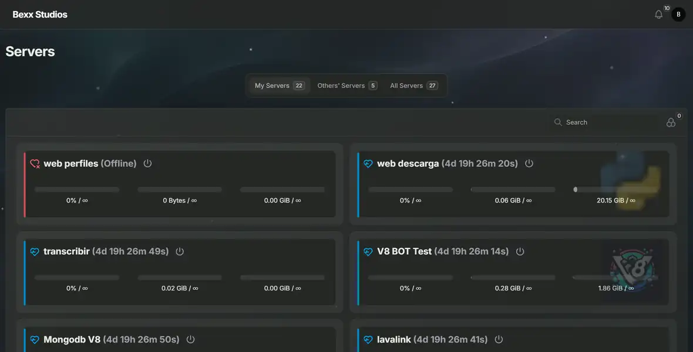

# Aether UI v0.4.0 — Atmosphere

**Pelican Panel:** `1.0.0-rc.4` (strict manifest requirement)  
**Plugin ID:** `aether-ui`  
**Category:** `theme` · **API:** 1 · **License:** MIT

## What's new

- **Aether Atmosphere:** original local background inspired by the upper sky, with pearl, ice-blue and muted lavender palettes.
- **Refined glass:** softly blurred, lightly translucent cards, inputs, modal surfaces, navigation and tables, with fine borders and restrained shadows.
- **Optional particles:** two slow CSS-only layers of atmospheric dust, with toggles for on/off and brightness. Reduced-motion, reduced-transparency and forced-color preferences are supported.
- **Native Pelican selector:** the official `App\Contracts\Plugins\HasTheme` integration loads styles and render hooks only while Aether is active.
- **Native UI:** Filament controls, file operations, console power actions, Livewire behavior and the xterm terminal are not replaced or patched.
- **Preserved settings:** existing saved settings remain intact, with Atmosphere defaults for clean installs and an opt-in `presets/atmosphere.json` for existing users.
- **Real screenshots:** updated [Screenshots](SCREENSHOTS.md) gallery and README hero from the running panel, showing Servers, Files, Console and Settings.

## Screenshots

[Browse all four real panel screenshots](SCREENSHOTS.md).

## Installation and compatibility

Download `aether-ui-0.4.0.zip`, import through **Administration → Plugins**, install or upgrade using Pelican's normal workflow and select Aether from the built-in theme picker. Pelican must be **exactly `1.0.0-rc.4`** for this manifest. Do not change Pelican core files or manually override plugin compatibility. The `-source.zip` archive is for development, not installation.

Users on rc.3 should keep Aether 0.3.0; on rc.2, keep Aether 0.2.4. Back up the panel and export existing plugin preferences before upgrading. Existing preferences are not reset by this release.

## Verification and limitations

The local release checks PHP 8.4 syntax, Node.js runtime and theme-selector tests, JS syntax, packaging and SHA-256 archive integrity. The supplied real dark-mode screenshots demonstrate rendering in the app, server and admin panel; they do **not** establish a complete production audit of authentication, all responsive breakpoints, light mode, plugin interoperability, remote Wings actions or fresh-install/upgrade/uninstall lifecycle. Check those paths on an isolated rc.4 staging panel before broad rollout.

GitHub Releases and Pelican Hub Marketplace publication are separate actions. No Pelican Hub submission or approval is implied.
