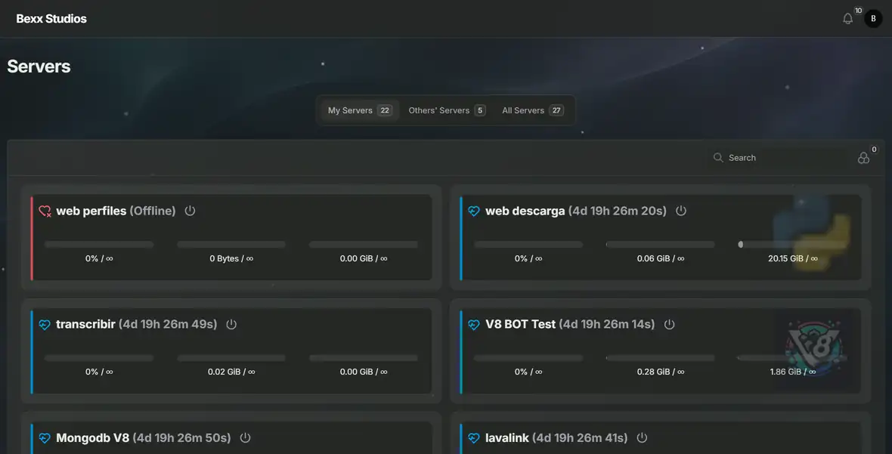
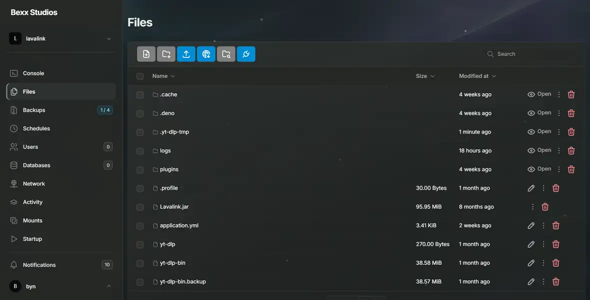
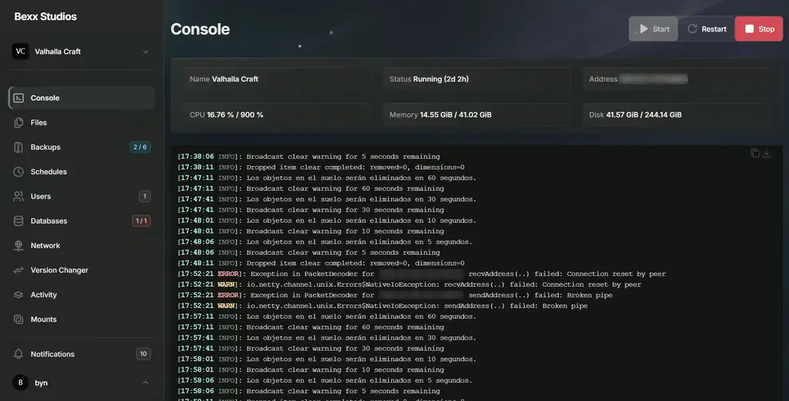
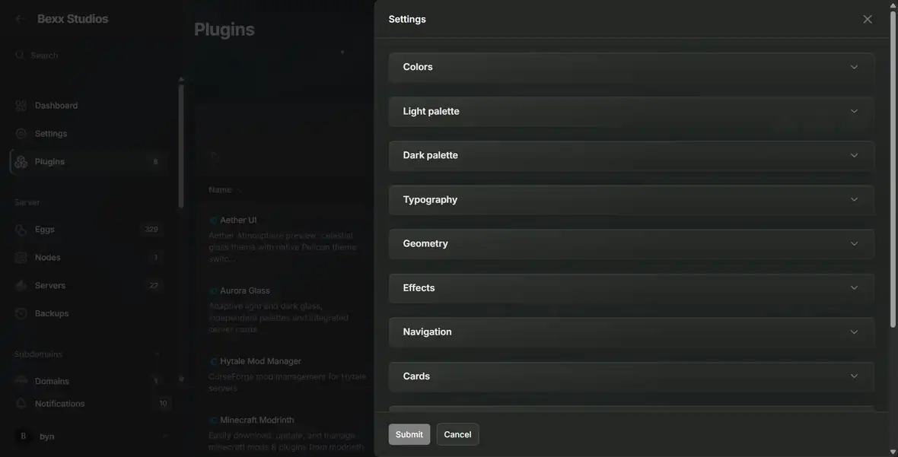

# Aether Atmosphere — Screenshots from Pelican Panel

These screenshots were captured from a running **Pelican Panel 1.0.0-rc.4** instance on **20 November 2026**, using the Aether Atmosphere 0.4.0-beta.2 test build in dark mode. The promoted 0.4.0 release retains its visual code; the release changes metadata and documentation only. They show actual panel pages rather than concept mockups. Server names, resources, counts, and backgrounds vary by installation. The capture does not, by itself, validate all light-mode, mobile, upgrade or third-party-plugin paths.

## Servers — Application (`app`)

The real server listing shows the theme's restrained glass containers, server-status colors, navigation, resource indicators and background particles. Server management actions are Pelican's native controls.

## Files — Server panel (`server`)

The file manager keeps the native upload, create, search, open/edit and delete affordances, with clear rows, boundaries and a softly blurred shell. The screenshot shows the directory listing, not a replacement file editor.

## Console — Server panel (`server`)

The console uses the native terminal and server power controls. Terminal text remains on an opaque surface for legibility, with the blur limited to surrounding cards and navigation.

## Appearance settings — Administration (`admin`)

The existing plugin settings form uses Filament's native modal, collapsible sections and submit/cancel actions. Theme selection itself is provided by Pelican's built-in switcher.

## Image usage and provenance

- Files in `docs/screenshots/` are original user-provided captures of a real running panel, not AI-generated mockups.
- The separate `docs/design-review/` images are historical **conceptual previews**, not evidence of a live panel.
- The glass appearance, particle intensity, server state and dark/light colors can change with user settings.
- Avoid reproducing real server identifiers or private endpoints from screenshots without review. Existing uploaded captures are preserved in their original form.
